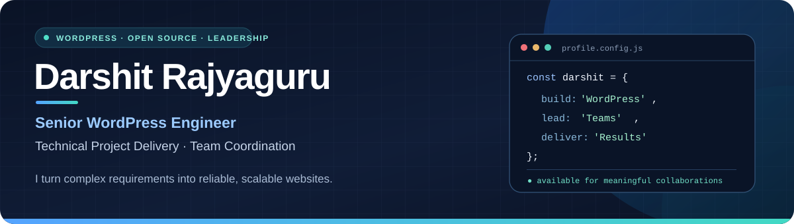
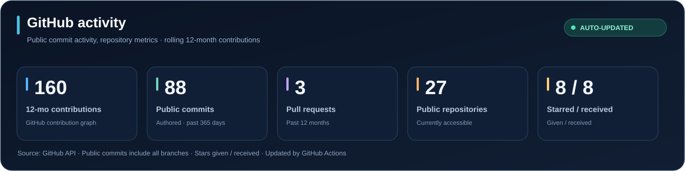

<!-- GitHub profile README — repository name must match your GitHub username: DarshitRajyaguru -->

  
   
   
  
  
  
  
   
   
  <strong>WordPress Core &amp; Core AI Contributor · Theme &amp; Plugin Developer · WooCommerce Specialist</strong>
   
  Based in India · Collaborating with clients and teams remotely

---

## 👋 About me

I'm **Darshit Rajyaguru**, a **Senior WordPress Developer with 5+ years of hands-on experience** delivering custom WordPress websites, WooCommerce solutions, reusable themes, plugins, and performance-focused web experiences.

My work goes beyond development. I help translate client requirements into **clear scope, realistic project estimates, actionable tasks, coordinated teamwork, and dependable delivery**. I enjoy being hands-on with architecture and code while keeping communication, quality, and timelines in focus.

| Engineering | Project delivery | Collaboration |
| :--- | :--- | :--- |
| Custom themes & plugins, WooCommerce, API integrations, Figma-to-WordPress | Discovery, scope definition, effort estimation, sprint planning, task tracking, QA & release coordination | Client calls & updates, team mentoring, work allocation, reviews, stakeholder alignment |

> **How I work:** Understand the business goal → estimate & plan → build thoughtfully → test thoroughly → communicate clearly → ship confidently.

## ✨ At a glance

| Experience | WordPress contributions | Published extensions | Working style |
| :---: | :---: | :---: | :---: |
| **5+ years** | **9 core releases** | **3 themes + 1 plugin** | **Hands-on engineering + team coordination** |

WordPress contributions and published products are linked below for independent verification.

## 🧭 Engineering, leadership & delivery

| Focus area | What I bring |
| :--- | :--- |
| **Project planning & estimation** | Requirement discovery, technical feasibility, effort breakdown, priorities, milestone planning, delivery estimates, and scope-change discussions. |
| **Team handling & coordination** | Task allocation, developer collaboration, progress monitoring, mentoring, code reviews, blockers, and cross-functional handoffs. |
| **Client communication** | Clear status reports, technical explanations in business language, expectation setting, feedback loops, and demo/review calls. |
| **WordPress architecture** | Maintainable custom themes/plugins, hooks, templates, CPTs, taxonomies, ACF/SCF, dynamic content, REST APIs, and coding standards. |
| **Commerce & integrations** | WooCommerce customizations, checkout improvements, payment integrations, form flows, AJAX, and third-party API connections. |
| **Quality & optimization** | Mobile responsiveness, accessibility fundamentals, performance, Core Web Vitals, technical SEO, security-conscious development, QA, and maintenance. |

## 🏗️ Published WordPress work

These projects are available in the official WordPress.org directory — not just mockups or private screenshots.

| Project | What it demonstrates | Explore |
| :--- | :--- | :--- |
| **RDS Novera** · Theme | Adaptable, accessibility-minded multipurpose WordPress theme with modern layouts and design flexibility. | [WordPress.org →](https://wordpress.org/themes/rds-novera/) |
| **RDS Portfolio** · Theme | Portfolio and personal-brand theme for developers, designers, freelancers, and agencies. | [WordPress.org →](https://wordpress.org/themes/rds-portfolio/) |
| **BlueBoxed** · Theme | Lightweight responsive blog theme focused on readability and clean presentation. | [WordPress.org →](https://wordpress.org/themes/blueboxed/) |
| **TypeForge CPT and Meta Builder** · Plugin | Developer-friendly setup for custom post types, taxonomies, and post meta without repetitive boilerplate. | [WordPress.org →](https://wordpress.org/plugins/typeforge-cpt-meta-builder/) |

**Beyond published products:** I also work on custom client websites, WooCommerce builds, design-to-code implementations, and developer-focused automation tools. See my [portfolio](https://darshitrajyaguru.github.io/Darshit-Portfolio/) for additional work.

## 🌱 WordPress open-source involvement

I'm active in the WordPress community across **Core, Core AI, testing, themes, documentation, and translations**.

- **WordPress Core Contributor:** credited on releases spanning **6.3–7.1** (9 releases shown on my WordPress.org profile).
- **Core AI Contributor:** involved in WordPress AI-related development and collaboration.
- **Theme & Plugin Developer:** creator of the published products linked above.
- **Community & localization:** contributions to Gujarati/Hindi translation, testing, documentation, and the wider WordPress ecosystem.

🔎 **[Explore my official WordPress.org contributor profile](https://profiles.wordpress.org/darshitrajyaguru97/)**

## 🛠️ Tech stack & workflow

**WordPress & E-Commerce**

**Languages & frontend**

**Design, development & delivery tools**

**AI tools & developer assistants**

<strong>Additional tools, platforms & practices</strong>

 

- **Builders & design:** Divi, WPBakery, Gutenberg blocks, Figma / Adobe XD to WordPress.
- **Hosting & deployment:** cPanel, Hostinger, Kinsta, LocalWP, staging-to-production workflows, backups, migrations.
- **Optimization:** caching/CDN, WP Rocket, LiteSpeed Cache, Cloudflare, SEO and accessibility checks.
- **Development workflows:** Git branching, REST/AJAX, MySQL, debugging, testing, Postman, CI-minded releases.
- **Delivery management:** Jira, Trello, Basecamp, sprint tracking, documentation, QA checklists, handoffs.
- **Client and team communication:** Google Meet, Microsoft Teams, Slack, Zoom, Google Chat, stakeholder meetings, technical demos, and status updates.
- **AI-assisted workflow:** Google Antigravity, OpenAI Codex, Claude AI, GitHub Copilot, Perplexity AI, Cursor, ChatGPT, and Gemini for research, prototyping, development support, and human-reviewed output.

## 🤝 Ways I can help

**Development:** Custom WordPress websites · Figma-to-WordPress · WooCommerce development & checkout improvements · Custom code solutions · Theme/plugin development · Performance fixes · Migrations & ongoing support.

**Delivery:** Technical scoping · Project estimation · Task breakdown · Team coordination · Sprint planning · Client communication · Code/QA reviews · Launch planning.

## 📈 GitHub activity & contributions

<strong>Live GitHub activity showcase</strong>

 

  

  <a href="https://github.com/DarshitRajyaguru?tab=repositories">Browse public repositories</a> ·
  <a href="https://github.com/DarshitRajyaguru?tab=overview">View GitHub's native contribution graph</a>

Stats are generated from the GitHub API. Contributions and pull requests reflect GitHub’s rolling 12-month contribution records; public authored commits include indexed public-branch commits over the past 365 days. The final card shows repositories I starred / stars received by my public repositories. Refreshed on profile pushes and scheduled checks roughly every 5 minutes, subject to GitHub Actions scheduling, indexing and image cache delays. Private activity and WordPress.org contributions are not included in these public metrics.

---

### Have a WordPress project or need a technical delivery partner?

**Let's discuss the scope, priorities, estimated effort, and a practical path to launch.**

Build with care. Lead with clarity. Deliver with confidence. · India 🇮🇳

